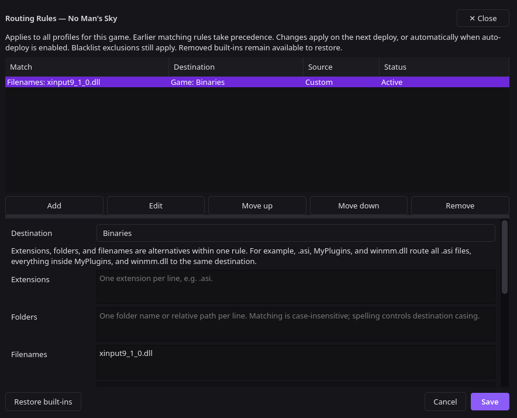

## Framework setup

It needs a one-time
Routing Rule so its DLL lands in the game's `Binaries/` folder: Data
tab > Routing Rules at the bottom near the Search bar > Add:
Destination `Binaries`, Filenames `xinput9_1_0.dll` > Save, then
deploy.



Only the framework DLL is routed by name. Any other `.dll` or `.asi`
files stay inside their mod folders, which is how the framework finds
them.

## ASI mods

Most ASI mods ship the same way: a loader DLL called
`xinput9_1_0.dll`, its `.ini` settings file, a `plugins` folder with
the actual mod (`.asi`), and a normal mod folder. [Salvage Express](https://www.nexusmods.com/nomanssky/mods/4754)
1.1, for example, ships `Binaries/xinput9_1_0.dll`,
`Binaries/xinput9_1_0.ini`, `Binaries/plugins/SalvageExpress.asi`,
and `GAMEDATA/MODS/SalvageExpress/`.

1. Delete `Binaries/xinput9_1_0.dll` and `Binaries/xinput9_1_0.ini`
   from the download.
2. Install the rest normally and deploy. The `.asi` in
   `Binaries/plugins/` loads on its own.

Prefer keeping everything in one folder instead? Move the `.asi`
into the mod's own folder and point the framework at it with a
`mod.toml`:

```toml
[mod]
id = "salvage-express"
version = "1.1"
label = "Salvage Express"
description = "Vent salvage at a deep-space outpost's corvette pad."
enabled = true
plugin = "SalvageExpress.asi"
```

## DLL mods

Some mods ship their code as a DLL with a system file name (like
`xinput9_1_0.dll` or `winmm.dll`) that goes into `Binaries/`.
Through the framework, that file lives in the mod's own folder
instead:

1. Move the DLL out of `Binaries/` and into the mod's folder under
   `GAMEDATA/MODS/`.
2. Rename it to something meaningful: `XINPUT9_1_0.dll` becomes
   `SnapAngles.dll`, for example.
3. Point the framework at it with a `mod.toml` in the same folder:

```toml
[mod]
id = "snap-angles"
version = "2.0.3"
label = "Snap Angles"
description = "Angle building pieces without losing snap."
enabled = true
plugin = "SnapAngles.dll"
```

If the folder has no `mod.toml` at all, every `.dll` in it loads
anyway. Either way, install only one copy: a copy in `Binaries/`
plus a copy in a mod folder runs the mod twice.
