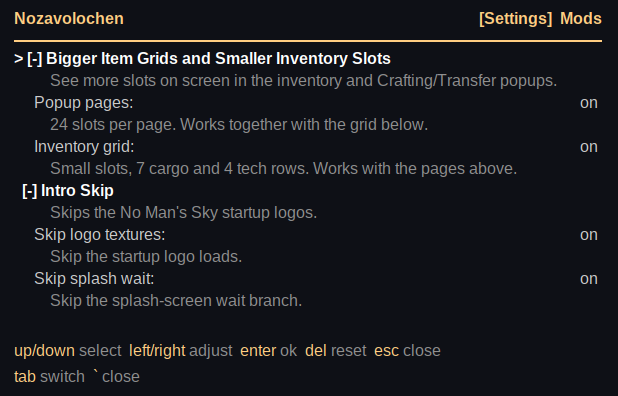
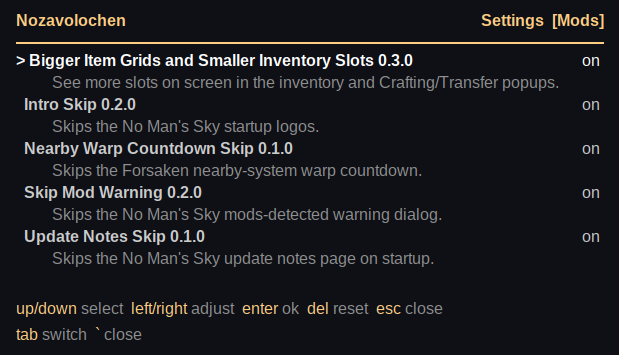

Press backtick (`` ` ``) in game to open the panel. Press
it again, or Escape, to close. Tab switches between the two pages.

## Settings

- Up/down moves between mod groups and setting rows.
- Left/right adjusts the selected value. On a mod group header it
  collapses or expands the group instead.
- Enter toggles a bool or steps an enum, and starts editing a text
  row (Enter commits, Escape cancels).
- Delete resets the selected row to its default. On a mod group
  header it resets the whole mod.
- Edits apply live and are written into the mod's own `mod.toml`,
  so hand-edits and overlay edits share one path. A value stays
  amber until the reload confirms it.

Only mods that have settings appear. Each row shows the setting
label and its current value; rows and mod headers may carry a
one-line description underneath. Rows of a disabled mod render
dimmed and ignore edits; switch the mod back on from the Mods
page first.

## Mods

Lists every installed mod with its version and on/off switch,
including mods with no settings (which the Settings page skips).
Folders whose `mod.toml` fails to parse appear with their error
instead of a switch.

- Up/down moves between mods.
- Left/right or Enter flips the selected mod's switch.
- Delete switches the mod back on.
- Switches apply live (patches revert when a mod goes off) and
  are written into the mod's own `mod.toml` as `enabled`.

While the panel is open, its keys do not reach the game.

Panel chrome follows the game language (read from
`Binaries/SETTINGS/GCUSERSETTINGSDATA.MXML`, Steam
`appmanifest_275850.acf` when the game follows Steam); unknown
languages fall back to English.
